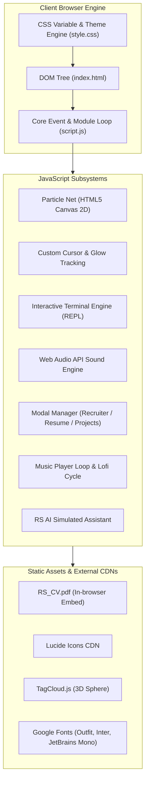
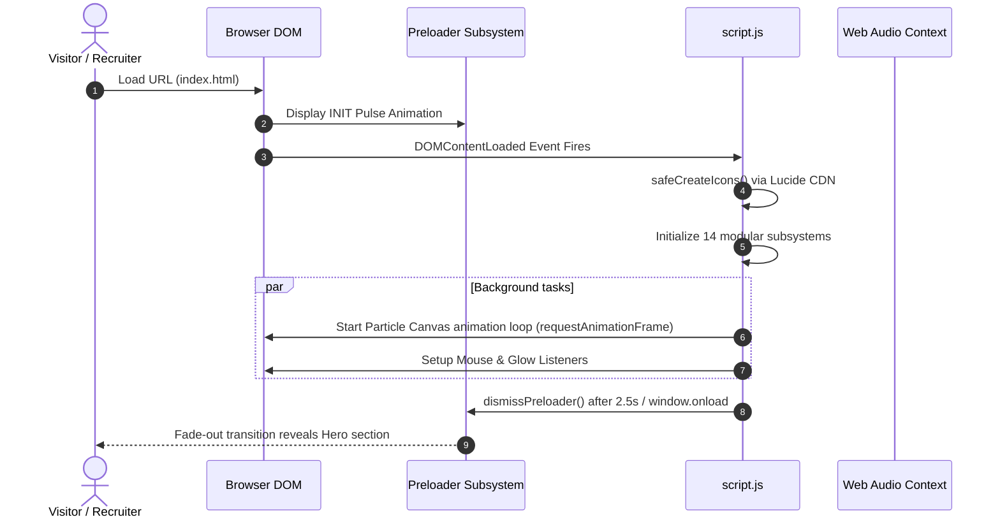
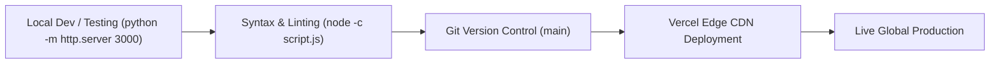

---

## 2. Engineering Working Process & Lifecycle

### Stage 1: Document Initialization & Bootstrap Flow

1. **Defensive Preloader Safety**:
   - The preloader uses a **triple-redundancy dismissal pattern**:
     1. Automatic delay after `DOMContentLoaded` (2500ms for brand aesthetic).
     2. `window.addEventListener('load')` when all remote fonts and styles resolve.
     3. An absolute hard fallback timeout at `6000ms` so a visitor is never locked out on slow networks.
2. **Safe Icon Injection**:
   - `safeCreateIcons()` verifies `window.lucide` is available before calling `.createIcons()`, preventing unhandled exceptions from halting execution.

---

## 3. Subsystem Engineering Breakdown

### A. The Interactive Terminal Subsystem (`initTerminal()`)
The terminal simulates an interactive Unix-style pseudo-terminal using a customized REPL (Read-Eval-Print-Loop):
- **Command Capture & History**:
  - Listens to `keydown` on `#terminal-input`.
  - Captures `ArrowUp` and `ArrowDown` to traverse an in-memory `commandHistory` array with pointer `historyIndex`.
- **Autocomplete Engine (`Tab`)**:
  - Intercepts default browser tab-focus behavior with `e.preventDefault()`.
  - Prefix-matches input against registered commands (`availableCommands.find(c => c.startsWith(...))`).
- **Command Dispatcher**:
  - Sanitizes user input (`.toLowerCase().trim().split(/\s+/)`).
  - Routes to command handlers: `whoami`, `status`, `neofetch`, `theme`, `download`, `ls`, `cat`.
  - Manipulates the DOM dynamically and auto-scrolls using `terminalBody.scrollTop = terminalBody.scrollHeight`.

### B. Synthesized Web Audio Engine (`initSoundEffects()`)
Rather than downloading heavy `.mp3` audio files which slow down page load:
- **Pure Native Web Audio API**:
  - Instantiates an `AudioContext` only after the first user gesture to comply with modern browser autoplay policies.
  - Generates tones mathematically via `OscillatorNode` (e.g., frequency `800Hz`, waveforms `sine` or `triangle`).
  - Shapes audio envelopes using `GainNode` with `exponentialRampToValueAtTime()` for crisp, click-free decay.
- **Opt-in Privacy & UX**:
  - Sound starts muted by default.
  - Toggled through the navbar speaker icon, saving user preference across interactions.

### C. The 60 FPS Particle Canvas System (`initParticles()`)
- **Canvas Math & Spatial Connections**:
  - Allocates an array of `Particle` objects with individualized `(x, y)` positions, sizes, and vector velocities `(speedX, speedY)`.
  - Runs inside a continuous `requestAnimationFrame(animate)` loop.
  - Computes Euclidean distance $d = \sqrt{\Delta x^2 + \Delta y^2}$ between every particle and the cursor.
  - If $d < \text{mouse.radius}$, an elastic repulsion force directs particles away from the cursor.
  - If distance between two neighboring particles is $< 100\text{px}$, draws a semi-transparent connecting line with opacity proportional to proximity.

### D. Modal & Dialog State Management
- Includes three discrete modal types:
  1. **Project Detail Modal**: Hydrates content dynamically from `data-*` attributes (`data-title`, `data-problem`, `data-solution`, `data-features`, `data-github`) on the clicked card.
  2. **Recruiter Mode Modal**: Provides a condensed 1-minute summary, locking page scroll (`document.body.style.overflow = 'hidden'`) while active.
  3. **Resume Preview Modal**: Embeds [RS_CV.pdf](file:///f:/Portfolio/RS_CV.pdf) into an internal sandbox `<iframe>` with hardware-accelerated rendering.
- **Global Event Isolation**:
  - Clicking outside the modal container on the overlay backdrop triggers dismissal.
  - Centralized `Escape` key listener closes whichever overlay is currently top-level.

### E. Dynamic Theme Management (CSS Variable Injection)
- Themes are driven by CSS Custom Properties (`--accent-primary`, `--accent-secondary`, `--accent-glow`).
- Switching themes (`theme cyberpunk`, `theme tokyo`, or Light/Dark toggle) mutates CSS variables directly on `document.documentElement.style` or applies class `.light-mode` on `document.body`.
- Repaints occur seamlessly without page reloading or layout recalculations.

---

## 4. Development & Deployment Pipeline

1. **Development & Local Verification**:
   - Run zero-dependency static server (`python -m http.server 3000` or `npx serve .`).
   - Validate JavaScript syntax using `node -c script.js`.
2. **Git Workflow**:
   - Changes committed to branch / `main`.
   - `.gitignore` prevents tracking local deployment builds and cache files (`.vercel`, system logs).
3. **Continuous Deployment (Vercel)**:
   - Configured via [.vercel](file:///f:/Portfolio/.vercel). Every push to `main` triggers a direct atomic deploy to the Vercel edge network, served over HTTP/2 with automatic TLS/SSL and Brotli compression.

